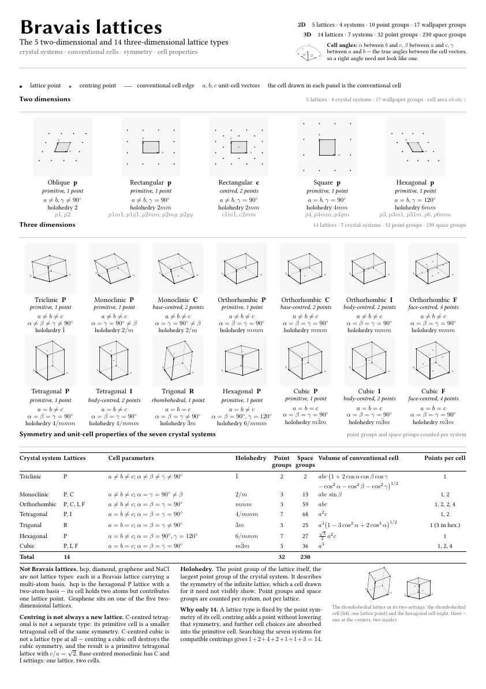
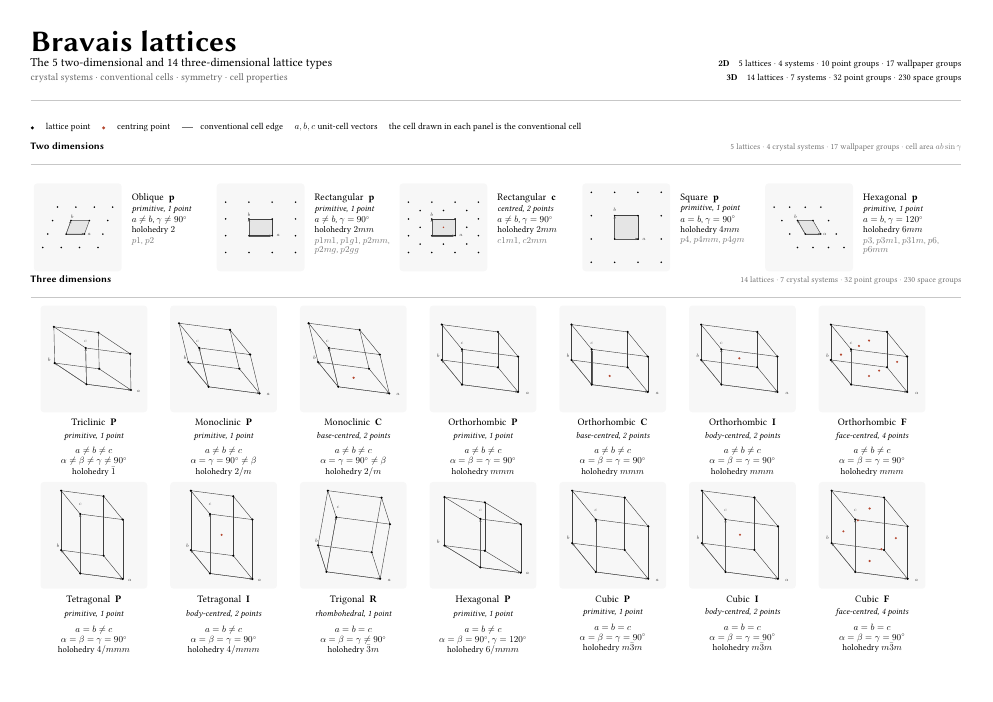
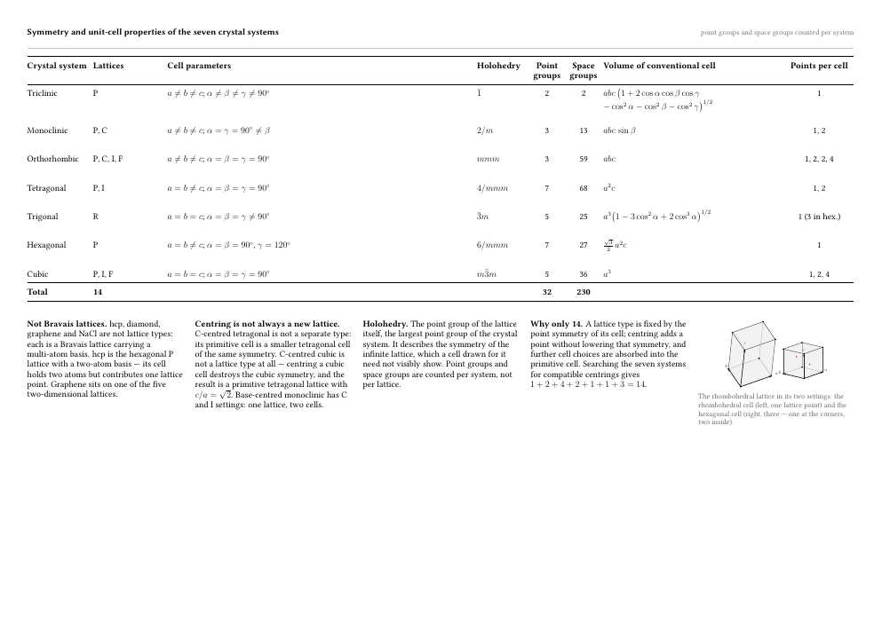

# Bravais lattice reference sheet

Two print-ready A3 sheets covering the 5 two-dimensional and 14
three-dimensional Bravais lattices: conventional cells drawn from their own
lattice vectors, crystal systems, centring, holohedry, point/space-group counts
and unit-cell properties.



| File | Format | Contents |
| --- | --- | --- |
| `bravais-lattices.pdf` | A3 portrait, 1 page | Wall sheet: legend, 5 2-D and 14 3-D cells, symmetry table, notes |
| `bravais-desk.pdf` | A3 landscape, 2 pages | Desk copy: page 1 the 19 cells at a larger size, page 2 the table and notes |

Desk copy, page 1 and page 2:

| | |
| --- | --- |
|  |  |

## Build

```sh
make            # both sheets
make poster     # A3 portrait only
make desk       # A3 landscape only
make clean      # remove intermediate files, keep the PDFs
make distclean  # also remove the PDFs
make preview    # refresh the PNG previews
```

Requirements: a TeX Live installation with `tikz`, `libertinus`, `booktabs`,
`tabularx` and `amsmath`, plus `python3` (standard library only) for the cell
geometry.

## How it is put together

`gen_cells.py` holds each lattice as six cell parameters, converts them to
vectors, projects them orthographically (a to the right, b receding up-left, c
up), fits each cell to a fixed panel and writes plain TikZ coordinates in
millimetres. Every drawing therefore follows from its parameters and cannot be
misplaced by hand.

```
gen_cells.py ──> cells.tex ────────┐
      │                            ├──> bravais-lattices.tex ──> bravais-lattices.pdf
      └──────> cells-desk.tex ─────┘            │
                                    bravais-desk.tex ──> bravais-desk.pdf
```

The generated `cells.tex` and `cells-desk.tex` are committed, so the PDFs can
be rebuilt with LaTeX alone; `make` refreshes them when `gen_cells.py` changes.

`bravais-desk.tex` is two lines: it sets `\deskbuild` and inputs the poster
source, which branches on that flag for paper geometry, column widths, figure
sizes, row spacing and page breaks. The content — 19 cards, the table, four
notes — is written once.

To change a cell, edit its parameters in `gen_cells.py` and rebuild. To change
the view, edit `KY_X`, `KY_Y`, `KX_Y` at the top; every cell follows.

## Reproducibility

The preamble sets `\pdfinfoomitdate`, `\pdfsuppressptexinfo` and an empty
`\pdftrailerid`, so two builds of the same source produce byte-identical
PDFs. Rebuilding does not churn the binaries in this repository.

## Conventions on the sheet

- Filled black dot: lattice point. Terracotta dot: centring point (face, body,
  base or cell centre).
- Thin grey line: edge of the conventional cell. Arrows: the cell vectors
  **a**, **b**, **c**.
- The panel in each card is a fixed frame, not part of the drawing.
- 2-D cells are drawn in plan with a patch of surrounding lattice points; the
  shaded parallelogram is the conventional cell.

## Sources and caveats

Values follow the International Tables for Crystallography, Vol. A: system
assignment, conventional cells, holohedral point groups (1̄, 2/m, mmm, 4/mmm,
3̄m, 6/mmm, m3̄m), 32 point groups and 230 space groups with their per-system
counts, and the standard cell-volume expressions.

Deliberate simplifications:

- The triclinic condition is written with a chained `≠` ("a ≠ b ≠ c, α ≠ β ≠ γ
  ≠ 90°"), the usual shorthand for "no accidental symmetry". It is not a strict
  logical restriction.
- The trigonal row lists the R lattice, which is the trigonal Bravais lattice.
  Seven of the 25 trigonal space groups (P3, P3₁21, …) instead use a primitive
  cell of the hexagonal lattice.
- Cell drawings use illustrative axial ratios and angles, not real substances.

## Licence

MIT — see [LICENSE](LICENSE).
